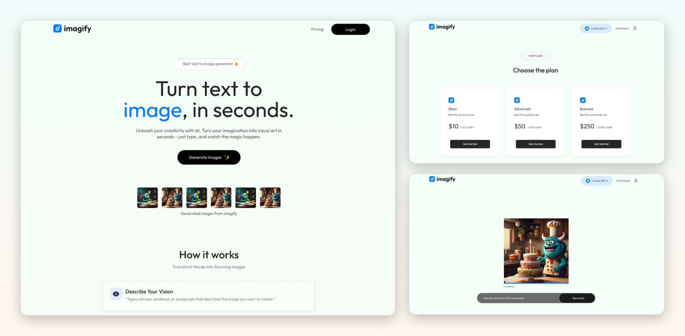

# imagify – AI Text to Image Generator



Describe an image in words and get it generated by AI in seconds. New users get 5 free credits; more credits can be bought with Stripe.

**[Demo video](YOUR_VIDEO_LINK)** · **[UI design reference](https://www.youtube.com/watch?v=DSGFZb8KiO8&list=PLjwm_8O3suyOFd8LTFqgw9v7MqPNtgINA&index=12)**

## Demo Access

Stripe runs in test mode, so no real money is used. You can also sign up with your own email and get 5 free credits.

| Field | Value |
| --- | --- |
| Demo email | |
| Demo password | |

**Stripe test card:** `4242 4242 4242 4242` · any future expiry · any 3-digit CVC

## Features

- Custom authentication (no third-party auth): secure sessions with httpOnly cookies
- Email verification with Brevo
- Text-to-image generation with one-click download
- 5 free credits per new user, 1 credit per image
- Redirect to the pricing page when credits run out
- Automatic credit refund if generation fails
- Stripe Checkout credit packs: $10 / 100, $50 / 500, $250 / 5000 credits
- Signature-verified, idempotent Stripe webhook
- Rate limiting and server-side validation
- Responsive UI built from the Figma design

## Tech Stack

| Layer | Technology |
| --- | --- |
| Web | Next.js 16, React, TypeScript, Tailwind CSS |
| Database | PostgreSQL (Neon) + Prisma |
| Auth | Custom (scrypt password hashing, DB-backed sessions) |
| Email | Brevo |
| Payments | Stripe Checkout + webhooks |
| AI images | Cloudflare Workers AI (FLUX.1-schnell), Clipdrop optional |

## How It Works

```
Browser -> /api/generate
   1. Check session and verified email
   2. Atomically take 1 credit (Prisma + Neon)
   3. Generate the image through the AI provider
   4. Return the image (refund the credit on failure)

Stripe Checkout -> webhook -> verify signature -> add credits once
```

## Run Locally

```bash
npm install
cp .env.example .env        # then fill in the values below
npx prisma migrate dev
npm run dev
```

In a second terminal, forward Stripe webhooks to your machine:

```bash
stripe listen --events checkout.session.completed,checkout.session.async_payment_succeeded \
  --forward-to localhost:3000/api/webhooks/stripe
```

Copy the `whsec_...` secret it prints into `STRIPE_WEBHOOK_SECRET` and restart the dev server.

## Environment Variables

```dotenv
# App
NEXT_PUBLIC_APP_URL=http://localhost:3000

# Neon: DATABASE_URL = pooled connection, DIRECT_URL = direct connection (for migrations)
DATABASE_URL=
DIRECT_URL=

# Brevo (email verification)
BREVO_API_KEY=
MAIL_FROM_EMAIL=
MAIL_FROM_NAME=imagify

# AI image provider: cloudflare (default) or clipdrop
IMAGE_PROVIDER=cloudflare

# Cloudflare Workers AI
CLOUDFLARE_ACCOUNT_ID=
CLOUDFLARE_API_TOKEN=

# Clipdrop (only if IMAGE_PROVIDER=clipdrop)
CLIPDROP_API_KEY=

# Stripe
STRIPE_SECRET_KEY=
STRIPE_WEBHOOK_SECRET=
```

Never commit your real `.env` file.

## Notes

- Built as a portfolio project; it is not publicly deployed.
- The free AI quota is shared across all users and resets daily.

## Roadmap

- Password reset
- Image gallery and history
- Public deployment on Vercel